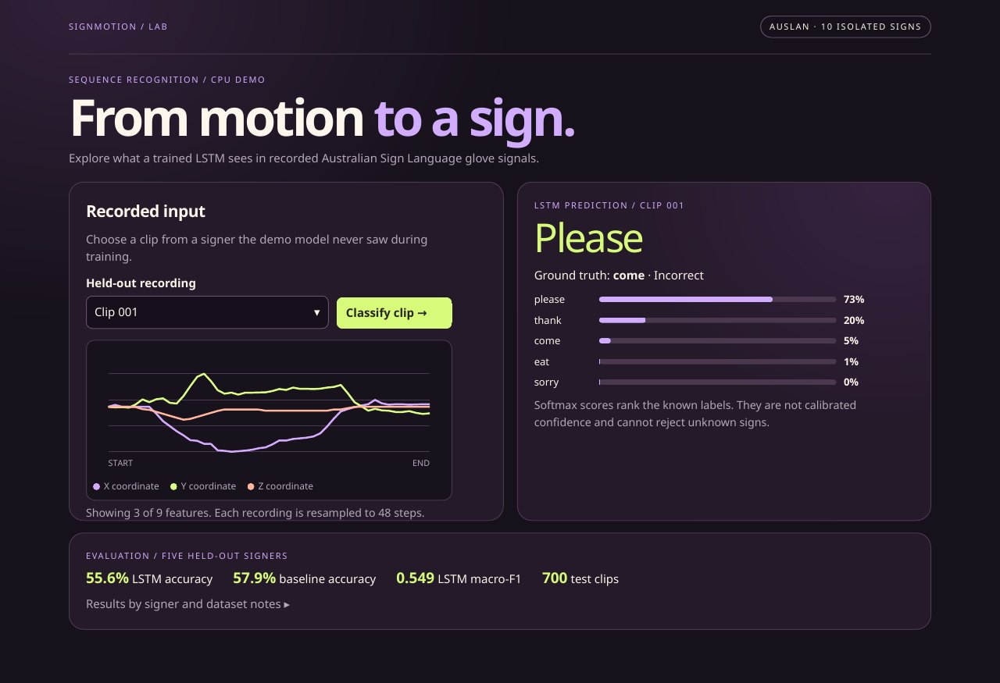

# SignMotion Lab

**An AI-assisted Python portfolio project:** recognize 10 isolated Australian Sign Language (Auslan) glosses from recorded instrumented-glove motion using a trained bidirectional LSTM. This is not webcam recognition or sign-language translation.



Static preview rendered from actual application HTML and real test inference with WeasyPrint. Native controls are approximated in the image; this is not a browser screenshot. [Mobile layout preview](preview-mobile.jpg).

## Run the demo

Use Python 3.12. Open PowerShell from a clone of this repository:

```powershell
py -3.12 -m venv .venv
.\.venv\Scripts\python -m pip install torch==2.7.1 --index-url https://download.pytorch.org/whl/cpu
.\.venv\Scripts\python -m pip install -r requirements.txt
.\.venv\Scripts\python app.py
```

On macOS use `python3.12 -m venv .venv`, then `.venv/bin/python -m pip install torch==2.7.1` (without the CPU wheel index), `.venv/bin/python -m pip install -r requirements.txt`, and `.venv/bin/python app.py`. On Linux use the same Unix commands with the CPU wheel index shown above.

Open **http://127.0.0.1:8011**. Select a numbered clip, choose **Classify clip**, then compare the top scores with the reference label. The first startup downloads the official UCI archive (~3 MB) and validates its SHA-256 before parsing. No account, microphone, webcam, or cloud inference is needed. For an offline run, supply the exact UCI ZIP with `python app.py --archive /path/to/auslan.zip`.

## What was tested?

700 recordings across five signers and a fixed 10-gloss vocabulary: come, drink, eat, go, hello, please, sorry, thank, wait (not yet), and write. Participant names are not shown in the UI. In each fold a distinct signer was used for test, another signer was used for early stopping, and three others were used to fit. The UI uses the test clips for fold C only, not all 700 clips.

| Model | Pooled accuracy | Pooled macro-F1 |
| --- | ---: | ---: |
| Bidirectional LSTM | 55.57% | 0.5488 |
| Order-free logistic regression | **57.86%** | **0.5776** |

The simpler baseline was better overall. LSTM fold accuracy varied from 38.75% to 65.50%; test fold C reached 47.22%. Five people are not enough to establish real-world performance or rule out signer, device or session effects. Softmax scores are not calibrated confidence. There is no unknown-sign rejection, continuous segmentation, conversational context, or webcam support. Results do not apply to other sign languages.

## Reproduce

```powershell
.\.venv\Scripts\python train.py
.\.venv\Scripts\python -m unittest -v
```

Run commands using the Unix venv executable on macOS/Linux. Training writes `model.pt` (fold C weights) and `report.json` (fold metrics and confusion matrix). The implementation was tested on Linux/Python 3.12, PyTorch 2.7.1 CPU and scikit-learn 1.6.1. Small cross-platform numerical differences are possible.

The parser retains position (X/Y/Z), roll as a sine/cosine pair, and four finger bends; each clip is linearly resampled to 48 timesteps. Scaling is fitted on each fold’s training signers only. The LSTM has 40 hidden units per direction, mean pooling, and a linear classification head. The baseline uses per-channel mean, standard deviation, minimum and maximum, with no time ordering.

## Data credit

Kadous, M. W. (1995). *Australian Sign Language Signs*. UCI Machine Learning Repository. [DOI: 10.24432/C5XG6C](https://doi.org/10.24432/C5XG6C). The [UCI dataset catalog](https://archive.ics.uci.edu/dataset/114/australian+sign+language+signs) lists [CC BY 4.0](https://creativecommons.org/licenses/by/4.0/). We used a 10-label subset and transformed its features as described above; no raw or preprocessed corpus is bundled. The archive contains additional historical usage notes. See M. W. Kadous, *GRASP: Recognition of Australian Sign Language using Instrumented Gloves*, UNSW honours thesis, for original methodology. Research/learning demo only.
